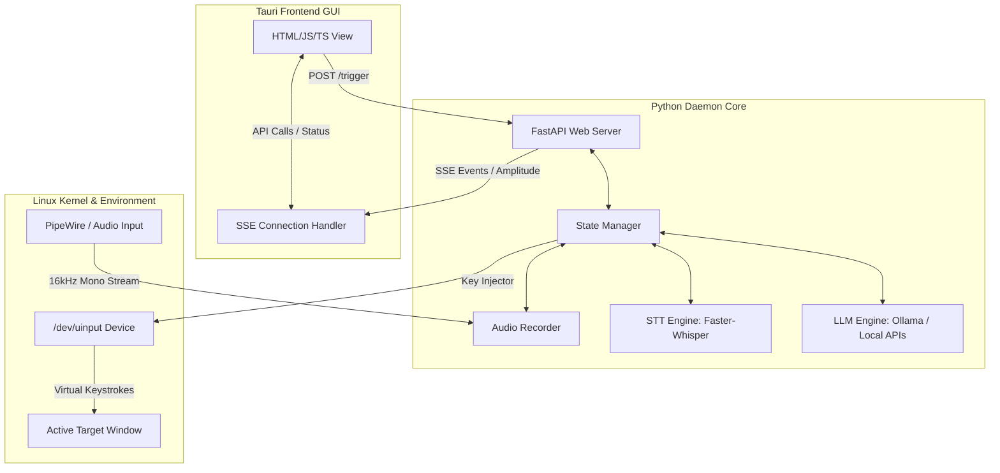

# ZOLA // VOICE TYPING FOR LINUX

[](https://github.com/MSpider3/ZOLA-Voice-typing-for-Linux/actions/workflows/release.yml)
[](https://github.com/MSpider3/ZOLA-Voice-typing-for-Linux/blob/main/LICENSE)
[]()

Zola is a high-performance, system-level Speech-to-Text (STT) voice-typing application specifically engineered for Linux desktops running Wayland (Fedora, Arch, Ubuntu). Designed with a distinct retro-military CRT terminal aesthetic, it provides five operation modes powered by local speech models (Faster-Whisper, or NVIDIA Nemotron via sherpa-onnx) and optional local LLM refinement.

## UI Previews

| Dashboard Console | Settings Menu |
|:---:|:---:|
|  |  |

| Recent Logs | Transcription History |
|:---:|:---:|
|  |  |

---

## Technical Architecture: How It Works

Traditional voice-typing apps on Linux face two major hurdles:
1. **Wayland Security Isolation:** Wayland compositors block applications from injecting synthetic keystrokes or sniffing global key events of other windows.
2. **Resource Thrashing:** Running AI transcription models on consumer hardware can lead to high memory consumption, CPU spikes, and laggy UI rendering.

Zola resolves these problems with a decoupled **split architecture**:



### Connection & Communication Architecture
* **Tauri HTTP REST API:** The frontend communicates with the backend daemon running on `http://127.0.0.1:5001`. For actions such as triggering recording, changing system settings, and updating active modes, the frontend issues standard HTTP `POST` requests.
* **API token:** every request must carry the token the daemon creates on first start in `~/.config/zola/token` (owner-only), as `Authorization: Bearer <token>` (or `?token=` on `/events`). This keeps other users and network-sandboxed apps from turning on your mic or reading your dictations; requests from web pages are also rejected by an Origin check.
* **Server-Sent Events (SSE):** Since transcription and recording states occur asynchronously on background threads, the backend pushes continuous status updates to the frontend using an SSE stream (`/events`). This includes active recording states and completed transcription text.
* **Exponential Backoff Connection Handler:** To ensure resilience, the frontend implements an exponential backoff reconnect handler with random jitter to automatically restore connection if the backend daemon restarts.

### Step-by-Step Program Lifecycle
1. **Shortcut Activation:** The user presses the keybind set in their desktop's shortcut settings (e.g., `Super + V`), which runs `zola-trigger`: a `POST` to `http://127.0.0.1:5001/trigger` carrying the API token.
2. **Audio Capture:** The backend opens the microphone through PortAudio (PipeWire/PulseAudio) at 16 kHz mono; microphones that only accept 44.1/48 kHz are recorded at their own rate and converted.
3. **Silence Detection (VAD):** The recorder runs Silero Voice Activity Detection. In batch mode, recording stops after `batch_silence_timeout_s` of silence (default 3 s) or on a second trigger.
4. **Transcription & Local LLM Refinement:** The recorded audio, kept in memory only, is passed to the local speech model. If LLM refinement mode is enabled, the text is sent to a local LLM (Ollama or an OpenAI-compatible server) to clean up punctuation and grammar.
5. **Text Injection:** The text is put on the Wayland clipboard (`wl-copy`, which handles all Unicode including Devanagari) and pasted with a key combo sent through the `/dev/uinput` virtual keyboard. If the clipboard is unavailable, ASCII text is typed key by key as a fallback.
6. **UI State Update:** A final event is pushed to the Tauri GUI via SSE to update the transcription logs and history.

### 1. Kernel-Level Keystroke Injection (`/dev/uinput`)
Instead of relying on XWayland bridges or compositor-specific protocols (like Niri, Sway, or GNOME shell extensions), the Zola backend registers a virtual keyboard device directly with the Linux kernel `/dev/uinput` subsystem called `zola-virtual-keyboard`. It uses it to send the paste key combo after copying the text to the clipboard (and, as an ASCII-only fallback, to type text key by key). This works in *any* active window (editors, browsers, chat tools).

### 2. High-Performance Audio Pipeline
- **In-Memory Audio:** 100 ms blocks of 16 kHz mono float32 audio go from the microphone callback to the recorder's buffer and straight to the model; nothing is written to disk.
- **VAD (Voice Activity Detection):** Silero runs in a worker thread, and the Whisper model is not invoked for silence.
- **Quantized CPU Inference:** Models run in `int8` on the CPU. Speed depends on the model: on a 2-core i3, Hinglish Swift runs at an RTF (processing time ÷ audio length) of 0.16 and Whisper `small` at 0.88 (see [STT_EVALUATION.md](STT_EVALUATION.md)).
- **Explicit Garbage Collection:** Numpy buffers and Whisper segments are explicitly deallocated (`del` followed by `gc.collect()`) immediately after inference to prevent memory fragmentation and spikes.

### 3. Asynchronous Event Synchronization
The Tauri frontend communicates with the backend via two channels:
- **HTTP POST Request Triggers:** To trigger recordings or change settings.
- **Server-Sent Events (SSE):** The frontend listens to `/events` for state changes and transcripts. To ensure resilience, the frontend implements an exponential backoff reconnect handler with random jitter.

### 4. Optimized Frontend Rendering
- **Canvas Visibility Throttling:** The CRT phosphor oscilloscope view uses the Page Visibility API. If the window is minimized or hidden, it draws a flat black frame (preventing frozen-frame compositor artifacts) and halts the animation loop, reducing GPU usage to 0%.
- **Targeted DOM Patching:** Rather than rebuilding the DOM on every event, Zola updates specific `.textContent` nodes for transcripts and statistics, avoiding layout thrashing.

---

## Key Features

- **Five Operation Modes:**
  1. **Batch STT:** The trigger starts recording; it stops after a pause (or a second trigger), then the whole recording is transcribed and pasted.
  2. **Batch + LLM Refinement:** As batch, with the text cleaned up by a local LLM before pasting.
  3. **Batch Translate (experimental):** As batch, with Whisper translating Hindi/Hinglish to English.
  4. **Realtime STT:** Text is pasted after each pause while you keep speaking.
  5. **Realtime + LLM Refinement:** As realtime, with a cleaned-up version of the whole session copied to the clipboard at the end.
- **CRT Phosphor Visualizer:** Green-glow analog oscilloscope driven by the live microphone level, with a dBFS readout that warns when the mic is too quiet.
- **Output options:** paste with Ctrl+V, Ctrl+Shift+V (terminals) or Shift+Insert; optionally restore your previous clipboard after pasting; start/stop sound cues; microphone selection.
- **Corrections:** a vocabulary hint (names and terms you use) and whole-word replacements (`STD => STT`) applied to every transcript.
- **History:** kept across restarts in `~/.local/share/zola/history.json` (can be turned off), with copy and clear buttons. `POST /cancel` discards a recording without typing anything.
- **Automatic Legacy Migration:** Automatically migrates configurations from `~/.config/speaktype/` to `~/.config/zola/` on boot without crashing.
- **Hardened Error Fail-safes:** Employs a custom `release_all()` routine ensuring that if the daemon crashes mid-injection, modifier keys (like Shift or Ctrl) do not remain stuck.

---

## Installation

**Fedora / openSUSE (.rpm) or Ubuntu / Debian (.deb):** download the package from the [latest release](https://github.com/MSpider3/ZOLA-Voice-typing-for-Linux/releases/latest) and install it (`sudo dnf install ./zola-*.rpm` or `sudo apt install ./zola_*.deb`). The package contains both the app and its speech daemon, plus the `/dev/uinput` access rule; log out and back in once, then open Zola — it starts the daemon itself (its log: `~/.local/state/zola/daemon.log`).

The `.AppImage` also contains the daemon and works the same way. To have the daemon start at login (so the dictation hotkey works without opening the window), use the one-line installer below instead.

## One-Line System Installation (AppImage + systemd)

Setting up Zola on Fedora, Arch, or Ubuntu requires only a single terminal command. This script downloads pre-compiled assets from GitHub, configures systemd, and registers uinput permissions.

```bash
curl -fsSL https://raw.githubusercontent.com/MSpider3/ZOLA-Voice-typing-for-Linux/main/install.sh | bash
```

> [!IMPORTANT]
> **Reboot or Relog Required:** The installer adds a udev rule that gives the logged-in user access to `/dev/uinput`. You must **log out and log back in** (or reboot) for it to take effect.

---

## Configuration & Settings (`~/.config/zola/settings.json`)

| Setting | Description |
|---|---|
| `spoken_language` | Sets language dictation mode: `en` (English), `hi` (Hindi), `mixed` (Hinglish), or `auto`. |
| `whisper_batch` | Model used for batch transcription (default: `small`). |
| `whisper_realtime` | Model used for realtime streaming (default: `base`). |
| `paste_method` | `ctrl_v` (default), `ctrl_shift_v` (terminals) or `shift_insert` (apps and terminals). |
| `restore_clipboard` | Put your previous clipboard text back after pasting (default: off). |
| `audio_feedback` | Short tones when recording starts and stops (default: on). |
| `input_device` | Microphone name from `GET /devices`; `null` = system default. |
| `replacements` | Whole-word fixes, e.g. `{"STD": "STT"}`. |
| `save_history` | Keep history across restarts (default: on). |
| `llm_api` | `ollama` (default) or `openai` for an OpenAI-compatible local server (llama.cpp server, LM Studio) at `ollama_url`. |

## Models

Zola runs local CTranslate2 `faster-whisper` models, plus extra model folders in `~/.local/share/zola/models/`. Measured on a 2-core Intel i3-1005G1 (word error rate; Hindi and Hinglish scored after romanizing so the output script does not count; RTF = processing time ÷ audio length):

| Model | English | Hindi | Hinglish | Your-voice Hindi / Hinglish | RTF | RAM | Output |
|---|---|---|---|---|---|---|---|
| **`hinglish-swift`** (Oriserve Hindi2Hinglish-Swift, int8, 78 MB) | 18% | **10%** | **12%** | 23% / 13% | **0.16** | 0.9 GB | Romanized Hinglish |
| **`nemotron-3.5`** (NVIDIA, sherpa-onnx int8) | **8%** | 17% | 36% | 13% / 45% | 0.34 | 1.0–1.5 GB | Devanagari + English |
| `base.en` / `small.en` | 11% / 12% | – | – | – | 0.12 / 0.31 | 0.9 / 1.5 GB | English only |
| `small` (default for new installs) | 16% | 44% | 51% | 46% / 29% | 0.88 | 1.4 GB | Devanagari |

- **Download from the app:** Settings → MODELS → DOWNLOAD, then pick the model for batch and realtime separately. Downloads come from fixed sources (`hinglish-swift` from [MSpider3/whisper-hindi2hinglish-swift-ct2](https://huggingface.co/MSpider3/whisper-hindi2hinglish-swift-ct2), `nemotron-3.5` from the sherpa-onnx release) and the models then run offline. Headless: `curl -X POST http://127.0.0.1:5001/models/download -H "Authorization: Bearer $(cat ~/.config/zola/token)" -H 'Content-Type: application/json' -d '{"name":"hinglish-swift"}'`.
- **Hindi / Hinglish speakers:** `hinglish-swift` for both batch and realtime (~10x faster than `small` and far more accurate). It writes Roman script, like most people type Hinglish.
- **Devanagari Hindi or best English:** `nemotron-3.5` with `spoken_language` set to `hi` or `en`.
- **English only:** `base.en` (fastest) or `small.en`.
- Installed models appear in Settings without restarting the daemon. Full evaluation: [STT_EVALUATION.md](STT_EVALUATION.md).

## Requirements

- **OS:** Linux (Wayland / X11)
- **Audio:** PipeWire or PulseAudio, and PortAudio (`portaudio` / `libportaudio2`; the .rpm/.deb install it automatically)
- **Dependencies (Backend):** Python 3.11+, `faster-whisper`, `sounddevice`, `evdev` (for `uinput` virtual keystrokes)
- **Dependencies (Frontend):** Tauri, WebKit2GTK

## Known Limitations

- **Ollama Translators**: The local HTTP endpoint `/trigger/batch-translate` is currently marked experimental. Native Whisper translation to English is heavily unreliable for Hinglish input.
- **Code-Switching Support**: `hinglish-swift` handles Hinglish in Roman script; no model tested writes mixed script (Hindi in Devanagari, English in Latin) reliably on a weak CPU.
- **LLM refinement on weak CPUs**: small models (1–2B) sometimes answer a dictated question or change the meaning; Zola discards such outputs, but refinement is slow (10–70 s on a 2-core CPU) and best left off there.

---

## Desktop Environment & Compositor Integration

To dictate globally in any active text field, bind a keyboard shortcut in your desktop to **`zola-trigger`**. It is installed by the `.rpm`/`.deb` (in `/usr/bin`) and by `install.sh` (in `~/.local/bin`); for a bare AppImage, download `zola-trigger` from the release and put it on your `PATH`. It starts/stops dictation with the API token from `~/.config/zola/token`, passed on stdin so it never shows in the process list. Zola's own "shortcut" setting is only a note.

### GNOME (Fedora Default)
1. Open **Settings** -> **Keyboard** -> **Keyboard Shortcuts** -> **View and Customise Shortcuts** -> **Custom Shortcuts**.
2. Click **Add Shortcut** (`+`).
3. Set **Name** to `Zola Voice Trigger`.
4. Set **Command** to `zola-trigger`.
5. Assign your preferred keybinding (e.g., `Super + V`).

### KDE Plasma
1. Open **System Settings** -> **Shortcuts** -> **Add New** -> **Command**.
2. Set the command to `zola-trigger`.
3. Set your preferred shortcut (e.g., `Meta + V`).

### Hyprland
Add this to your configuration file (usually `~/.config/hypr/hyprland.conf`):
```ini
# Trigger active Zola transcription mode
bind = $mainMod, V, exec, zola-trigger
```

### Sway
Add this to your configuration file (usually `~/.config/sway/config`):
```sway
# Trigger active Zola transcription mode
bindsym Mod4+v exec zola-trigger
```

### Niri
Add this to your configuration file (usually `~/.config/niri/config.kdl`):
```kdl
// Float the Zola Voice Terminal window nicely in the center
window-rule {
    geometry-corner-radius 8
    clip-to-geometry

    match title="ZOLA // VOICE TERMINAL" {
        block-out-from "fullscreen"
        open-floating true
        default-floating-position x=100 y=100
        default-column-width { proportion 0.45; }
    }
}

// Start the daemon at login, so the hotkey works without opening the window
spawn-at-startup "/usr/bin/zola-daemon"

binds {
    // Super+V: Toggle Active Voice Typing mode
    Mod+V { spawn "zola-trigger"; }
}
```

---

## Contributing

Contributions are welcome! Please follow these guidelines:

1. **Reporting Issues:** Search existing issues before opening a new one. Provide system specs (CPU, GPU, Wayland/X11, Compositor) and the backend daemon log: `~/.local/state/zola/daemon.log` when the app started the daemon (rpm/deb/AppImage), or for the `install.sh` systemd service:
   ```bash
   journalctl --user -u zola-backend.service -n 100
   ```
2. **Pull Requests:** 
   - Fork the repository and create your branch from `main`.
   - Ensure changes build locally. Clean the build caches if you experience path errors:
     ```bash
     cd zola-frontend/src-tauri
     cargo clean
     ```
   - Commit messages should be clear and follow conventional commit styling (e.g. `feat: ...`, `fix: ...`, `docs: ...`).

---

## License

MIT License. See [LICENSE](LICENSE) for details.
